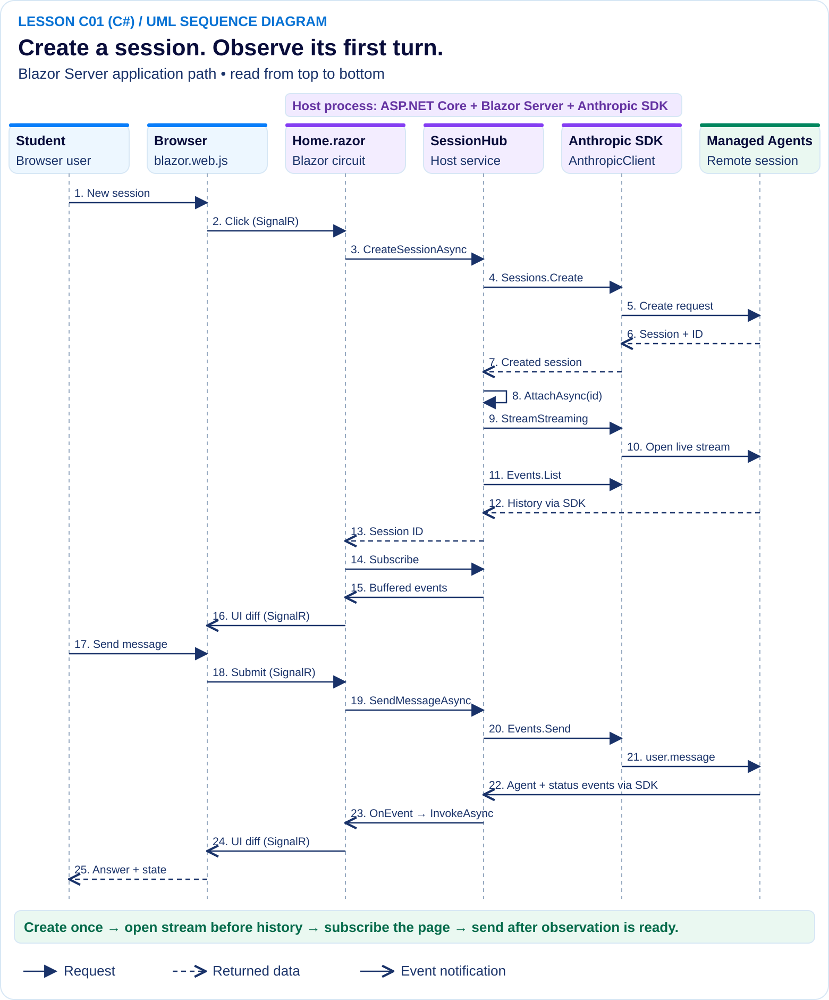

# Architecture and workflow (C# / Blazor Server)

The running app explains this same material at `/architecture`, with every code excerpt checked against the source by `dotnet test`. This document is the version you can read without starting the app.

PNG version: [images/architecture.png](images/architecture.png). The diagram is generated by `scripts/build-sequence-diagram.py`.

## Participants

| Participant | Where it runs | Role |
|---|---|---|
| Student | — | Clicks buttons and reads the activity feed. |
| Browser (`blazor.web.js`) | Student's browser | Shows the HTML that Blazor renders. Sends clicks and form submits to the server over a SignalR connection. Holds no API key and runs no SDK code. |
| `Home.razor` | Server, inside the Blazor *circuit* | The session lab component. Every event handler (`CreateAsync`, `SendAsync`, `ActionAsync`, …) runs on the server. |
| `SessionHub` | Server (singleton) | The host's only gateway to Managed Agents. Owns the per-session `SessionFeed` buffers. |
| Anthropic SDK (`AnthropicClient`) | Server (singleton) | `client.Beta.Sessions.*`, `client.Beta.Agents.*`, `client.Beta.Environments.*`. |
| Managed Agents | Anthropic | Runs the agent loop and its sandbox. |

`Home.razor`, `SessionHub` and the SDK all run inside one ASP.NET Core process: the **host**.

## Two connections carry events

1. **Provider stream: Managed Agents → SDK → `SessionHub`.** `SessionHub` opens it with `client.Beta.Sessions.Events.WithRawResponse.StreamStreaming(id)`. The hub keeps one stream per session, and every tab viewing that session shares it.
2. **Blazor circuit: server ↔ browser, over SignalR.** When a component changes its state, Blazor sends only the changed parts of the page to the browser.

The Node.js version had a browser `EventSource` and `/api/sessions/...` routes in between. Blazor Server needs neither: the component calls `SessionHub` directly as a C# method call.

## Walkthrough (arrow numbers match the diagram)

1. **Create the remote session (1–7).** Clicking **New session** runs `Home.CreateAsync` on the server. It calls `SessionHub.CreateSessionAsync`, which calls `Sessions.Create` with the configured agent, the environment and a 50¢ `BetaManagedAgentsBudgetLimit`.
2. **Prepare observation (8–12).** `AttachAsync` → `OpenAsync` opens the event stream **before** it calls `Events.List(id)` to read the history. Awaiting `WithRawResponse.StreamStreaming` returns once the HTTP stream is open, so events produced while the history loads are buffered in the stream. Every event goes through `SessionFeed.Emit`, which skips IDs it has already seen.
3. **Connect the page (13–16).** `CreateSessionAsync` attaches before it returns the ID. If attaching fails, it throws `SessionAttachException`, which carries the created session ID. `Home.ConnectAsync` then calls `feed.Subscribe(OnEvent)`. That call returns the buffered events and registers the listener inside one lock, so no event is lost or duplicated in between.
4. **Send a prompt (17–21).** `Home.SendAsync` rejects empty text and text over 20,000 characters. It then calls `SessionHub.SendMessageAsync`, which attaches if needed and sends a `BetaManagedAgentsUserMessageEventParams`.
5. **Observe the response (22–25).** A background task reads the stream with `stream.Enumerate()` and passes each event to `Emit`. Each subscribed component's `OnEvent` calls `InvokeAsync(...)` to switch to the component's renderer, updates the feed and the status, and calls `StateHasChanged()`. Blazor then sends the change to the browser. Razor HTML-encodes `@item.Text`, so agent output is displayed as text and never interpreted as HTML.
6. **Reconnect.** `ConnectAsync` saves the session ID in the tab's `sessionStorage` through a small JavaScript helper called with `IJSRuntime`. When the student comes back from the guide, the page fills the ID back in. Nothing reconnects until the student clicks **Connect**. If the hub still has a reader for that session, `AttachAsync` reuses it (`ConcurrentDictionary` + `Lazy<Task<SessionFeed>>`, so two tabs never open two streams for one session).

### Optional branches

- **Pending action.** **Allow** and **Deny** send `BetaManagedAgentsUserToolConfirmationEventParams` with `ToolUseID` and `Result`. **Send result** sends `BetaManagedAgentsUserCustomToolResultEventParams` with `CustomToolUseID` and the text. Approving a tool call and supplying a tool result are two different operations.
- **Interrupt and inspect.** **Interrupt work** sends `BetaManagedAgentsUserInterruptEventParams`. That only means the interrupt was *sent*. **Inspect session** calls `Sessions.Retrieve` and adds the snapshot to the feed so you can check the remote state.

## Events as JSON

The hub turns every SDK event into a `JsonElement` with `JsonSerializer.SerializeToElement`. The SDK models serialize to their wire format, including fields this SDK version doesn't know about. That lets the page read exactly the fields the API documents (`type`, `id`, `content`, `stop_reason.type`, `stop_reason.event_ids`), just as `app.js` did.

## Configuration and secrets

`LabSettings.From(IConfiguration)` reads `ANTHROPIC_API_KEY`, `CLAUDE_MANAGED_AGENT_ID` and `CLAUDE_MANAGED_ENVIRONMENT_ID` from ASP.NET Core configuration. Values come from user secrets in Development, and environment variables override them. Values that start with `your_` count as missing. The `AnthropicClient` is registered as a singleton with that key, so no Razor component and nothing in the browser can read it.

## What is not durable

`SessionFeed` lives only in host memory. Restarting the server loses the buffers, but not the remote sessions: **Connect** reloads the full history from the API.

## Explain it back

- Which two connections carry events?
- Why must the provider stream open before the history is read?
- Which component decides how to respond to a pending action?
